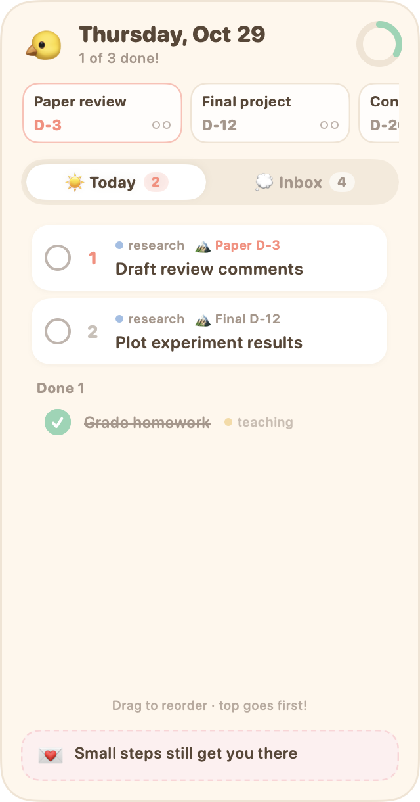
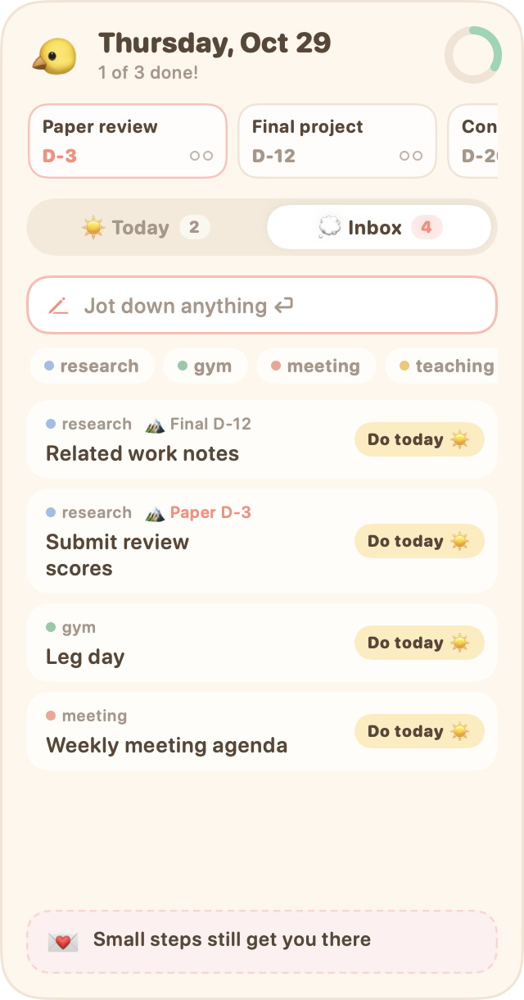
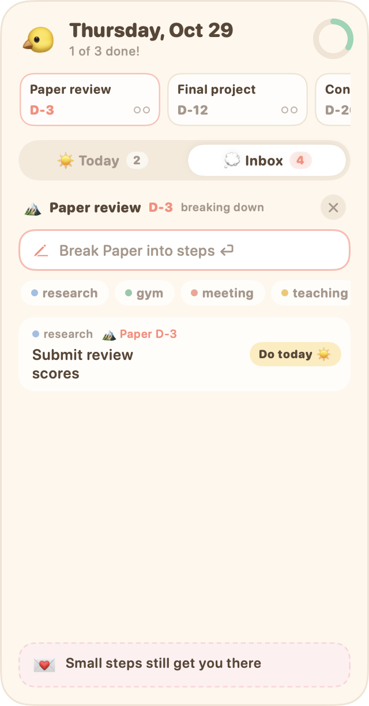

<p align="center"></p>

<h1 align="center">TodoPick</h1>

**Jot down everything, pick today's few, do them in order — a cozy macOS desktop widget.**

[한국어 README](README.md)

<p align="center">
  
  
  
</p>

---

## Why

Most to-do apps ask **"when?"** the moment you write something down. But when a task pops into your head, you usually don't know yet. Forced dates turn into a red pile of overdue items, and you stop opening the app.

TodoPick runs your day like this:

1. **Write down whatever comes to mind.** No dates. (💭 Inbox)
2. **In the morning, pick only what you'll do today.** (☀️ Today)
3. **Order today's picks.** Top goes first.
4. **Whatever you didn't finish quietly returns to the Inbox after midnight.** No guilt — just a 🔁 count of how many times it came back.

Big tasks with deadlines (a paper review, a final project) don't move until you break them into small steps. So a **deadline strip** sits at the top: D-days are always visible, and a big task you haven't broken down yet shows `⚠︎ not split`.

And a **note to yourself for today** stays at the bottom.

## Features

- **💭 Inbox**: dump to-dos without dates, one per line + ⏎.
- **☀️ Today**: pick with `Do today`, drag to reorder.
- **Auto roll-over**: unfinished items go back to the Inbox the next day with a 🔁 count.
- **Types**: free-form tags like `#research`, `#teaching`, `#gym`, each with its own color dot.
- **🏔 Deadline strip**:
  - Shows each big task with its D-day, highlighted within 3 days.
  - Click a card to break it into steps; progress dots show how many steps are done.
  - Past due + every step done → archived automatically. All steps done before the due date → `✓ All done?`.
- **💌 Note to self**: one line a day, always visible.
- **Summon from anywhere**: `⌃⌥T` brings the widget above all windows; `Esc` or clicking elsewhere sends it back to the desktop.
- **Menu bar**: today's top task and progress at a glance.
- **Korean / English UI**, switchable any time.

## Install

TodoPick isn't signed with an Apple developer ID, so **you build it on your own Mac**. No Xcode needed; it takes about a minute.

**Requirements**: macOS 14 (Sonoma) or later, Apple Silicon or Intel, Xcode Command Line Tools

```bash
xcode-select --install
```

```bash
git clone https://github.com/keyeun/TodoPick.git
```

```bash
cd TodoPick && ./build.sh install --lang en
```

`install` builds the app, copies it to `~/Applications/TodoPick.app`, launches it, and turns on launch at login. Without `--lang`, the first install asks which language you want. The widget appears at the top right of your screen; drag it anywhere by its background.

To update: `git pull`, then `./build.sh install` again. Your data and language stay as they are.

## How to use

### Typing shortcuts

| You type | Example | Meaning |
|---|---|---|
| plain text | `Groceries` | add to Inbox |
| `#type` | `Squats #gym` | set the type |
| `@deadline` | `Related work @paper` | link to a big task (first word of its name, any case) |
| both | `Review draft #research @paper` | type + big task |
| new big task | `Paper review 11/5` | type into the strip's `+`. `Nov 5`, `11.5`, `2027-01-10` work too |

**Double-click** a to-do to edit it; changing the `#` / `@` parts changes its type and big task.

### With the mouse

- **`Do today ☀️`** in the Inbox moves a to-do to Today.
- **Drag** to-dos in Today to reorder them.
- **Hover** a to-do for ↩︎ (send back to Inbox) or 🗑 (delete).
- **Right-click** for move up/down, type, deadline, delete.
- **Click a type chip** to tag everything you type next.
- **Click a deadline card** to break it down. Right-click it for finish, extend, edit, delete.
- **Click 💌** to write today's note.

### Keys and menu bar

| | |
|---|---|
| `⌃⌥T` | bring the widget to the front / put it back |
| `Esc` | send the widget back to the desktop |
| menu bar icon | bring to front, always on top, open at login, language, open data folder, quit |

## Data & privacy

**TodoPick never connects to the internet.** No account, no server, no sync, no analytics. Your to-dos live only on this Mac.

- **Location**: `~/Library/Application Support/TodoPick/` (menu bar → `Open data folder`)
  - `tasks.json`: to-dos
  - `deadlines.json`: big tasks
  - `tags.json`: types and their color order
  - `quotes.json`: daily notes
  - `archive/YYYY-MM.jsonl`: old completed records
- **Permissions**: folder `700`, files `600`. Other accounts on the same Mac can't read them.
- **No networking code**, and you can check:
  ```bash
  ./build.sh check-offline
  ```
- **Not synced to iCloud.** Time Machine backs it up locally like any other file.
- **Tip**: turn on **FileVault** (System Settings → Privacy & Security) so the disk is encrypted if your Mac is lost.
- **Logs**: only short error messages, never your to-do text.

### Won't the history grow huge?

No.
- **To-dos and big tasks finished more than 30 days ago** move to `archive/` once a day, so the live files stay small and the app stays fast.
- **Steps linked to a still-active big task** stay put, so its progress stays accurate.
- **Size**: a to-do is about 200 bytes. Finishing 20 a day adds **about 1.5 MB a year**.
- **Cleaning up**: archive files are monthly; delete old months freely.
- **Changing the window**: edit `archiveAfterDays` in [`Sources/Store.swift`](Sources/Store.swift).

## FAQ

**Why not a Notification Center widget (WidgetKit)?**
WidgetKit widgets can't take text input, and jotting things down instantly is the whole point. So TodoPick is a small app window pinned to the desktop — which also means it builds without Xcode.

**Other windows cover the widget.**
- Press `⌃⌥T` to bring it to the front.
- Or use Show Desktop (spread thumb and three fingers, or `fn+F11`).
- Or turn on menu bar → `Always on top`.

**The widget disappeared.**
- The app may not be running. Open `~/Applications/TodoPick.app` or run `./build.sh install` again.
- If it's off-screen, reset its position and relaunch:
  ```bash
  defaults delete local.todopick.widget "NSWindow Frame TodoPickWidget"
  ```

**`⌃⌥T` clashes with another app.**
Change `HotKey(keyCode: kVK_ANSI_T, modifiers: controlKey | optionKey)` in [`Sources/App.swift`](Sources/App.swift), then `./build.sh install`.

**How do I switch languages?**
Menu bar icon → `Language`. It switches immediately.

**Moving to another Mac?**
Install there, then copy `~/Library/Application Support/TodoPick/` over. There's deliberately no sync.

**Dark mode?**
Not yet — only the cream light theme for now.

**Uninstall**
```bash
./build.sh uninstall
```
This turns off launch at login and removes the app. Delete `~/Library/Application Support/TodoPick/` too to erase your data.

## Development

```bash
./build.sh               # build only (build/TodoPick.app)
./build.sh test          # logic tests (temp folder; never touches your data)
./build.sh screenshots   # redraw docs/*.png (Korean) and docs/en/*.png (English)
./build.sh check-offline # confirm there's no networking code
```

All UI text goes through `L("한국어", "English")` in [`Sources/Strings.swift`](Sources/Strings.swift) — please add both when you add UI text. `TODOPICK_DIR=/some/folder` runs the app against a different data folder.

Issues and PRs welcome. To keep it light, notifications, calendar views, and sync are intentionally left out.

## License

[MIT](LICENSE)
