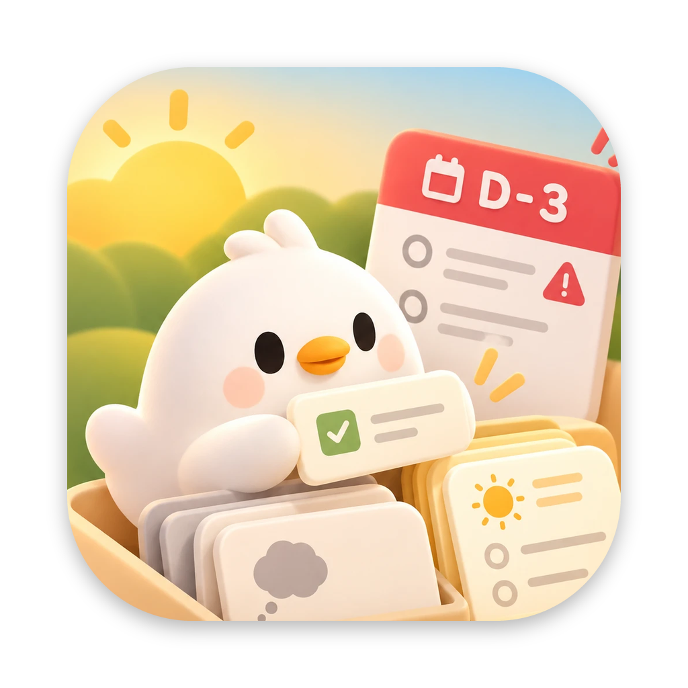
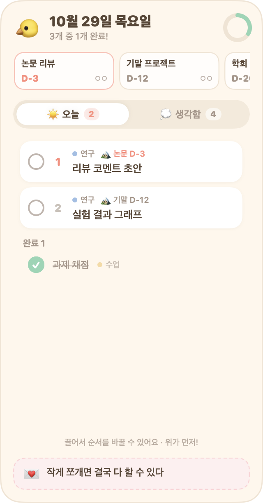
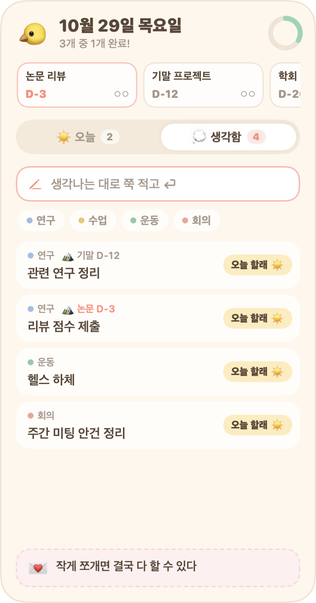
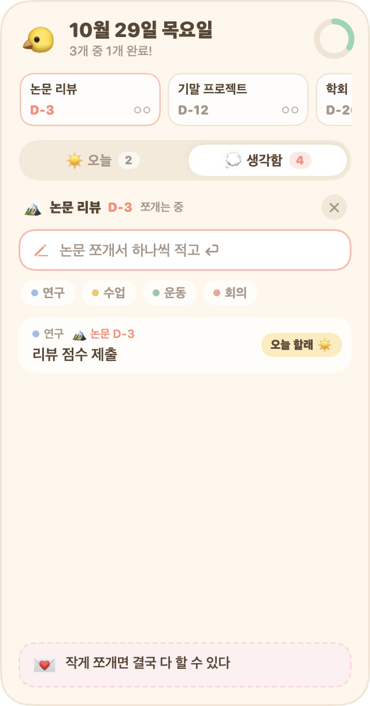

<p align="center"></p>

<h1 align="center">TodoPick</h1>

**생각나는 대로 적고, 오늘 할 일만 골라서, 순서대로 하는 맥 바탕화면 위젯.**

A tiny macOS desktop widget: dump every to-do as it comes to mind, pick today's few, order them, and let unfinished ones flow back automatically. Big deadlines sit on top so you remember to break them down. Everything stays on your Mac. Korean and English UI — **[English README](README.en.md)**.

<p align="center">
  
  
  
</p>

---

## 왜 만들었나요

할 일 앱은 대부분 할 일을 적는 순간 **"언제 할 건지"부터 묻습니다.** 그런데 실제로 할 일이 떠오를 때는 날짜가 아직 정해지지 않은 경우가 많아요. 날짜를 억지로 정하면 밀린 할 일이 빨갛게 쌓이고, 결국 앱을 열기 싫어집니다.

TodoPick은 하루를 이렇게 굴리려고 만들었어요:

1. **떠오르는 대로 다 적는다.** 날짜는 묻지 않아요. (💭 생각함)
2. **아침에 "오늘 할 것"만 고른다.** (☀️ 오늘)
3. **고른 것끼리 순서를 정한다.** 위에 있을수록 먼저 해요.
4. **오늘 못 끝낸 일은 자정이 지나면 조용히 생각함으로 돌아간다.** 밀렸다고 혼내지 않고, 몇 번 돌아왔는지(🔁)만 알려줘요.

그런데 연구, 수업 조교, 외부 프로젝트를 같이 하다 보면 날짜 없는 작은 할 일과 별개로 **마감이 있는 큰 일**이 있어요. 큰 일은 "논문 리뷰 11/5"처럼 큰 덩어리로 둬서는 진행이 안 되고, 작은 할 일로 쪼개야 손이 갑니다. 그래서 위젯 맨 위에 **마감 띠**를 두었어요. 큰 일의 D-day가 항상 보이고, 아직 하나도 쪼개지 않은 큰 일은 `⚠︎ 안 쪼갬`으로 알려줘요.

여기에 매일 스스로에게 남기는 **오늘의 한마디**를 위젯 아래에 붙였습니다.

## 기능

- **💭 생각함**: 날짜 없이 쭉 적는 곳이에요. 한 줄에 하나씩 적고 ⏎를 누르면 돼요.
- **☀️ 오늘**: 생각함에서 `오늘 할래`로 고른 것들이 모여요. 끌어서 순서를 바꿀 수 있어요.
- **자동 이월**: 오늘 못 끝낸 일은 다음 날 생각함으로 돌아가고 🔁 횟수가 표시돼요.
- **종류(태그)**: `#연구`, `#수업`, `#운동`처럼 자유롭게 만들 수 있어요. 종류마다 색 점이 붙어요.
- **🏔 마감 띠**:
  - 큰 일과 D-day를 보여줘요. 마감 3일 전부터는 강조돼요.
  - 카드를 누르면 그 큰 일을 작은 할 일로 쪼개는 모드가 돼요.
  - 쪼갠 할 일이 얼마나 끝났는지 진행도가 보여요.
  - 큰 일이 끝나면 정리돼요. 마감이 지났고 쪼갠 할 일을 다 끝냈으면 자동으로, 마감 전에 다 끝냈으면 `✓ 다 했어요?`를 눌러서 정리해요.
- **💌 오늘의 한마디**: 하루에 한 줄 적어두면 위젯 아래에 항상 보여요.
- **어디서든 불러오기**: `⌃⌥T`를 누르면 위젯이 모든 창 위로 올라와요. `Esc`를 누르거나 다른 창을 클릭하면 다시 바탕화면으로 내려가요.
- **메뉴 막대**: 오늘 1순위 할 일과 진행도(`☀️ 리뷰 코멘트 초안 1/3`)가 항상 보여요.

## 설치

TodoPick은 Apple 개발자 서명이 없어서 **각자 자기 맥에서 직접 빌드**해서 써요. Xcode는 필요 없고, 1분이면 끝나요.

**필요한 것**: macOS 14 (Sonoma) 이상, Apple Silicon 또는 Intel 맥, Xcode Command Line Tools

```bash
xcode-select --install
```

```bash
git clone https://github.com/<your-id>/TodoPick.git
```

```bash
cd TodoPick && ./build.sh install
```

`install`을 실행하면 이렇게 돼요:
1. 처음 설치할 때 UI 언어(한국어 / English)를 물어봐요. `./build.sh install --lang ko`처럼 바로 정할 수도 있어요.
2. 앱을 빌드해서 `~/Applications/TodoPick.app`에 넣어요.
3. 앱을 실행해요.
4. 로그인 시 자동 실행을 켜요.

위젯은 화면 오른쪽 위에 나타나요. 배경을 끌어서 원하는 곳에 두면 돼요.

업데이트할 때는 `git pull` 후 `./build.sh install`을 다시 실행하면 돼요. 데이터와 언어 설정은 그대로 남아요.

## 사용법

### 입력 문법

| 적는 것 | 예시 | 의미 |
|---|---|---|
| 그냥 적기 | `장보기` | 생각함에 추가 |
| `#종류` | `스쿼트 #운동` | 종류(태그) 지정 |
| `@큰일` | `관련 연구 정리 @논문` | 그 큰 일에 묶기 (이름 첫 단어, 대소문자 무관) |
| 같이 쓰기 | `리뷰 초안 #연구 @논문` | 종류 + 큰 일 |
| 큰 일 추가 | `논문 리뷰 11/5` | 마감 띠의 `+`에서 입력. `11.5`, `11월 5일`, `Nov 5`, `2027-01-10`도 돼요 |

할 일을 **더블클릭**하면 고칠 수 있어요. 고칠 때 `#`, `@` 부분을 바꾸면 종류와 큰 일도 같이 바뀌어요.

### 마우스로

- **생각함의 `오늘 할래 ☀️`**: 오늘로 옮겨요.
- **오늘의 할 일 끌기**: 순서를 바꿔요.
- **할 일 위에 마우스를 올리면**: ↩︎(생각함으로 돌려보내기)나 🗑(삭제) 버튼이 나타나요.
- **오른쪽 클릭**: 우선순위 올리기/내리기, 종류, 마감, 삭제를 할 수 있어요.
- **종류 칩 클릭**: 그다음에 적는 할 일에 그 종류가 자동으로 붙어요.
- **마감 카드 클릭**: 그 큰 일을 쪼개는 모드로 들어가요. 오른쪽 클릭하면 끝냈어요, 연장, 이름·날짜 고치기, 삭제를 할 수 있어요.
- **💌 카드 클릭**: 오늘의 한마디를 써요.

### 단축키와 메뉴 막대

| | |
|---|---|
| `⌃⌥T` | 위젯을 모든 창 위로 불러오기 / 다시 넣기 |
| `Esc` | 위젯을 바탕화면으로 되돌리기 |
| 메뉴 막대 아이콘 | 위젯 불러오기, 항상 위에 띄우기, 로그인 시 자동 실행, 언어, 데이터 폴더 열기, 종료 |

## 데이터와 프라이버시

**TodoPick은 인터넷에 연결하지 않아요.** 계정도, 서버도, 동기화도, 분석 도구도 없고, 할 일은 설치하신 맥에만 저장돼요.

- **저장 위치**: `~/Library/Application Support/TodoPick/` (메뉴 막대의 `데이터 폴더 열기`로 바로 열 수 있어요)
  - `tasks.json`: 할 일
  - `deadlines.json`: 큰 일
  - `tags.json`: 종류와 색 순서
  - `quotes.json`: 날짜별 한마디
  - `archive/YYYY-MM.jsonl`: 끝난 지 오래된 기록
- **권한**: 폴더는 `700`, 파일은 `600`이에요. 같은 맥의 다른 사용자 계정은 읽을 수 없어요.
- **네트워크 코드 없음**: 직접 확인할 수 있어요.
  ```bash
  ./build.sh check-offline
  ```
  `URLSession`, `Network` 프레임워크, iCloud API, `http(s)://` 주소가 소스에 하나도 없는지 검사해요.
- **iCloud 동기화 안 됨**: `Application Support` 폴더는 iCloud Drive로 동기화되지 않아요. Time Machine을 쓰고 있다면 다른 파일처럼 로컬 백업에 포함돼요.
- **추천**: 맥을 잃어버렸을 때를 대비해 **FileVault**(시스템 설정 → 개인정보 보호 및 보안)를 켜두세요. 디스크 전체가 암호화돼요.
- **로그**: 오류가 날 때만 시스템 로그에 짧게 남기고, 할 일 내용은 절대 기록하지 않아요.

### 기록이 쌓이면 용량이 커지지 않나요?

커지지 않게 정리돼요.
- **끝난 지 30일이 지난 할 일과 큰 일**은 하루에 한 번 `archive/` 폴더로 옮겨져요. 할 일 파일에는 지금 쓰는 것만 남아서 앱이 계속 가벼워요.
- **진행 중인 큰 일에 묶인 할 일**은 기간이 지나도 옮기지 않아요. 진행도가 정확해야 하니까요.
- **용량**: 할 일 하나가 약 200바이트라서, 하루 20개씩 끝내도 아카이브는 **1년에 약 1.5MB**예요. 사진 한 장보다 작아요.
- **지우고 싶으면**: 아카이브는 월별 파일이라 필요 없는 달은 그냥 지워도 앱에 영향이 없어요.
- **보관 기간 바꾸기**: [`Sources/Store.swift`](Sources/Store.swift)의 `archiveAfterDays`를 고치면 돼요.

## FAQ

**Q. 왜 macOS 알림 센터 위젯(WidgetKit)이 아닌가요?**
WidgetKit 위젯에는 글자를 입력할 수 없어요. TodoPick은 생각나는 대로 바로 적는 게 핵심이라, 바탕화면에 붙어 있는 작은 앱 창으로 만들었어요. 덕분에 Xcode 없이 빌드할 수 있어요.

**Q. 다른 창에 가려서 위젯이 안 보여요.**
- `⌃⌥T`를 누르면 맨 위로 올라와요.
- 트랙패드에서 엄지와 세 손가락을 벌리거나 `fn+F11`로 바탕화면을 보면 위젯이 바로 보여요.
- 늘 위에 두고 싶으면 메뉴 막대 → `항상 위에 띄우기`를 켜면 돼요.

**Q. 위젯이 아예 사라졌어요.**
- 앱이 꺼진 상태일 수 있어요. `~/Applications/TodoPick.app`을 실행하거나 `./build.sh install`을 다시 실행하세요.
- 위젯이 화면 밖으로 나갔다면 위치를 초기화하고 다시 실행하세요.
  ```bash
  defaults delete local.todopick.widget "NSWindow Frame TodoPickWidget"
  ```

**Q. `⌃⌥T`가 다른 앱과 겹쳐요.**
[`Sources/App.swift`](Sources/App.swift)에서 `HotKey(keyCode: kVK_ANSI_T, modifiers: controlKey | optionKey)`를 원하는 키로 바꾸고 `./build.sh install`을 다시 실행하세요.

**Q. 다른 맥으로 옮기고 싶어요.**
새 맥에 설치한 뒤 `~/Library/Application Support/TodoPick/` 폴더를 그대로 복사하면 돼요. 동기화 기능은 일부러 넣지 않았어요.

**Q. 처음 실행할 때 "확인되지 않은 개발자" 경고가 떠요.**
직접 빌드한 앱에서는 보통 뜨지 않아요. 다른 사람이 빌드한 `.app`을 받아 실행하면 뜰 수 있어요. 그래서 직접 빌드하는 걸 권해요.

**Q. 언어를 바꾸고 싶어요.**
메뉴 막대 아이콘 → `언어`에서 한국어 / English를 고르면 바로 바뀌어요. 다시 설치하면서 `./build.sh install --lang en`으로 바꿔도 돼요. 마감 날짜는 두 언어 모두 `11/5`, `11월 5일`, `Nov 5` 형식을 다 알아들어요.

**Q. 다크 모드는 없나요?**
아직 없어요. 지금은 크림색 라이트 테마만 지원해요.

**Q. 지우고 싶어요.**
```bash
./build.sh uninstall
```
로그인 시 자동 실행을 끄고 앱을 지워요. 할 일 데이터까지 지우려면 `~/Library/Application Support/TodoPick/` 폴더도 삭제하세요.

## 개발

```
Sources/
  Model.swift         TodoItem, Deadline, #/@ 파싱, 날짜 파싱
  Strings.swift       언어 설정과 L("한국어", "English") 도우미
  Store.swift         저장·이월·아카이브·마감 로직 (TodoStore)
  App.swift           창, 단축키, 메뉴 막대
  WidgetView.swift    위젯 전체 레이아웃
  TodayView.swift  InboxView.swift  DeadlineViews.swift
  TagViews.swift   QuoteCard.swift  Components.swift  Theme.swift
Tools/
  Tests.swift         로직 테스트
  Screenshots.swift   README 스크린샷 (가짜 예시 데이터)
  make_icon.py        Resources/icon-source.webp → AppIcon.png (macOS 아이콘 규격)
Resources/
  AppIcon.png         앱 아이콘 (빌드할 때 .icns로 변환돼요)
```

```bash
./build.sh               # 빌드만 (build/TodoPick.app)
./build.sh test          # 로직 테스트 (임시 폴더 사용, 내 데이터는 안 건드림)
./build.sh screenshots   # docs/*.png (한국어), docs/en/*.png (영어) 다시 그리기
./build.sh check-offline # 네트워크 코드 없는지 검사
```

화면에 보이는 글자는 모두 [`Sources/Strings.swift`](Sources/Strings.swift)의 `L("한국어", "English")`로 감싸요. 새 문구를 넣을 때 두 언어를 같이 적어주세요.

`TODOPICK_DIR=/some/folder` 환경 변수를 주면 다른 데이터 폴더로 실행할 수 있어요. 테스트할 때 내 데이터를 건드리지 않으려고 넣은 기능이에요.

Issues와 PR 환영해요. 다만 "가볍게 적고, 오늘만 고른다"는 컨셉을 지키려고 알림, 캘린더 뷰, 동기화 같은 기능은 일부러 넣지 않고 있어요.

## License

[MIT](LICENSE)
